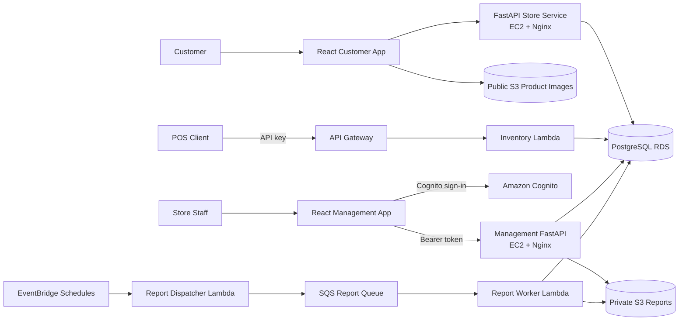

# A+mazon

A cloud-native grocery inventory platform that connects a customer storefront, a point-of-sale (POS) API, and an authenticated management portal to a shared inventory system on AWS.

A+mazon demonstrates the evolution of a small full-stack application into a multi-service cloud system. Customers can browse products and store-level availability, POS clients can query prices and update inventory, and authenticated staff can manage product offerings and subscribe to scheduled sales reports.

> **Project status:** `main` contains the complete implementation formerly developed on the `fifth_assignment` branch. The project was built as a cloud-computing portfolio project and is intended for learning and demonstration rather than production use.

## Overview

The project has three primary entry points:

- **Customer storefront:** Browse stores, categories, products, and current inventory through a React application backed by FastAPI.
- **POS API:** Query inventory and prices, deduct stock, submit batch purchases, and restock products through API Gateway and Lambda.
- **Management portal:** Sign in with Amazon Cognito, manage store offerings and quantities, configure report subscriptions, and access generated CSV reports.

The repository also includes Terraform infrastructure, deployment automation, seeded sample data, a POS smoke-test client, and traffic/restocking simulators.

### Project evolution

| Milestone | Main addition |
| --- | --- |
| Initial implementation | Customer React app, FastAPI API, EC2, S3, and Terraform |
| `second_assignment` | PostgreSQL on RDS, store-level inventory, and seed data |
| `third_assignment` | API Gateway, Lambda-based POS API, and API-key access |
| `forth_assignment` | Cognito authentication, management portal, and scripted deployment |
| `fifth_assignment` → current `main` | Subscriptions, scheduled report generation, SQS, EventBridge, and simulators |

## Architecture



### Request and data flow

1. The customer service and management service run independently on EC2 behind Nginx and are managed by `systemd`.
2. Customer and management services share the same PostgreSQL database, while the management API validates Cognito JWTs before allowing protected operations.
3. POS requests enter through API Gateway and require an API key. A Lambda function performs inventory and pricing operations directly against RDS.
4. EventBridge invokes the report dispatcher at configured intervals. The dispatcher finds active subscriptions and sends one task per report to SQS.
5. The report worker consumes SQS messages, queries transactions for the requested time window, generates CSV files, stores them in a private S3 bucket, and records their metadata in PostgreSQL.

## Tech Stack

| Layer | Technologies | Role |
| --- | --- | --- |
| Customer frontend | React 18, Axios, Semantic UI React, MUI | Store and product browsing UI |
| Management frontend | React 18, AWS Amplify, Cognito UI, Axios, Semantic UI React, MUI | Authenticated inventory and subscription management |
| Web APIs | Python 3.11, FastAPI, Uvicorn, SQLModel | Customer and management services |
| Database | PostgreSQL 18.1 on Amazon RDS | Products, stores, inventory, transactions, subscriptions, and reports |
| POS integration | API Gateway, API keys, Python Lambda, `pg8000` | Inventory queries and transactional stock updates |
| Reporting pipeline | EventBridge, Lambda, SQS, S3 | Scheduled asynchronous CSV report generation |
| Authentication | Amazon Cognito, JWT, `python-jose` | Management-user authentication |
| Infrastructure | Terraform `>= 1.2`, AWS provider `~> 5.92` | Reproducible AWS provisioning |
| Hosting and deployment | EC2, Nginx, systemd, Bash, SCP | Application hosting and deployment automation |

## Key Features

### Customer storefront

- Select a store and browse its available products.
- Navigate a multi-level category hierarchy.
- View product pricing, images, and store-specific quantities.
- Retrieve product images from S3.

### POS inventory API

- Query whether a product meets a minimum stock level with `GET /inventory`.
- Calculate the effective product or product-line sale price with `GET /price`.
- Deduct one item with `POST /deduct`.
- Deduct multiple items as one database transaction with `POST /deduct-batch`.
- Find low-stock products with `GET /inventory_need_restock`.
- Add inventory with `POST /add`.
- Require an API key through API Gateway for all POS routes.

### Management portal

- Authenticate staff through an administrator-managed Cognito user pool.
- View stores, categories, offered products, and unoffered products.
- Offer or remove products from a store.
- Update store-level quantities.
- Create report subscriptions by store or category.
- List, pause, resume, and delete subscriptions.
- Access reports created during a user's subscribed periods, including historical reports retained after cancellation.

### Scheduled reporting

- Generate reports every minute, hour, day, week, or month.
- Use EventBridge to initiate scheduled work.
- Use SQS to decouple report dispatch from report generation.
- Generate CSV reports from transaction data and store them in a private S3 bucket.

### Simulation tools

- Generate configurable POS purchase traffic.
- Poll for low inventory and automatically restock matching products.
- Exercise successful and failing POS scenarios with the sample client.

## Getting Started

### Prerequisites

For local backend or frontend development:

- Python 3.11
- Node.js 20 and npm
- PostgreSQL

For AWS deployment:

- An AWS account with permissions for the resources declared under `infra/`
- AWS CLI configured for `us-east-1`
- Terraform 1.2 or newer
- Bash, SSH, and SCP; Windows users can use Git Bash
- An EC2 RSA key pair named `vockey`, with its `.pem` file available locally

> **Cost warning:** Terraform creates EC2 instances, RDS, S3 buckets, Lambda functions, API Gateway, Cognito, SQS, EventBridge rules, and VPC endpoints. These resources may incur AWS charges. Destroy resources when they are no longer needed.

> **Security note:** Use a dedicated IAM identity and least-privilege permissions. Do not commit AWS credentials, database passwords, API keys, `.pem` files, or generated `.env` files.

### Repository layout

```text
.
├── client/                 # Customer React application
├── server/                 # Customer-facing FastAPI service
├── management_web/         # Authenticated management React application
├── management_server/      # Management FastAPI service
├── infra/                  # Terraform and Lambda source
├── scripts/                # AWS deployment and Cognito user scripts
├── sample_pos_client/      # Manual POS smoke-test client
├── simulator/              # Traffic and restocking simulators
└── s3_images/              # Seed product images uploaded during deployment
```

### Local customer API

Create a PostgreSQL database named `grocery`, then create `server/.env`:

```dotenv
DATABASE_URL=postgresql://dbadmin:<password>@localhost:5432/grocery
```

Install dependencies, create tables and seed data, then run the API:

```bash
cd server
python -m venv venv
source venv/bin/activate
pip install -r requirements.txt
python -m src.seeds.database
python -m src.seeds.seed_data
uvicorn main:app --host 127.0.0.1 --port 8000 --reload
```

On Windows PowerShell, activate the environment with:

```powershell
.\venv\Scripts\Activate.ps1
```

API documentation is available at <http://localhost:8000/docs>.

### Local customer frontend

The customer React app proxies API requests to `http://localhost:8000`.

```bash
cd client
npm install
npm start
```

Open <http://localhost:3000>.

### Local management service

The management service requires an existing Cognito user pool and report bucket. Create `management_server/.env`:

```dotenv
DATABASE_URL=postgresql://dbadmin:<password>@localhost:5432/grocery
COGNITO_USER_POOL_ID=<user-pool-id>
COGNITO_CLIENT_ID=<app-client-id>
REGION=us-east-1
REPORT_BUCKET=<report-bucket-name>
```

Then run:

```bash
cd management_server
python -m venv venv
source venv/bin/activate
pip install -r requirements.txt
uvicorn main:app --host 127.0.0.1 --port 8000 --reload
```

Create `management_web/.env`:

```dotenv
REACT_APP_USER_POOL_ID=<user-pool-id>
REACT_APP_CLIENT_ID=<app-client-id>
```

Start the management frontend:

```bash
cd management_web
npm install
npm start
```

The two React projects and two FastAPI services use the same default development ports. Run the customer and management stacks separately, or change the ports and proxy configuration when developing them simultaneously.

### Deploy to AWS

The deployment script configures AWS credentials, plans and applies Terraform, uploads product images, deploys both frontend/backend pairs to EC2, and seeds the database.

```bash
chmod +x scripts/deploy.sh scripts/deploy_ec2.sh
./scripts/deploy.sh
```

The script prompts for:

1. AWS CLI credentials and default region.
2. An RDS database password.
3. The local path to the EC2 `.pem` file.

After deployment, inspect the generated endpoints and resource identifiers:

```bash
cd infra
terraform output
```

Important outputs include:

- `client_ec2_ip`
- `management_ec2_ip`
- `rds_endpoint`
- `api_base_url`
- `user_pool_id`
- `user_pool_client_id`
- `s3_images_bucket_name`
- `s3_reports_bucket_name`

### Create a management user

After Terraform has created the Cognito user pool:

```bash
./scripts/create_user.sh
```

Enter an email address and a temporary password. The user will be prompted to replace the temporary password during the first login.

### Run the POS smoke client

The smoke client obtains the API URL and API key from Terraform and AWS CLI output.

```bash
cd sample_pos_client
pip install -r requirements.txt
python pos_test.py
```

> This script sends requests to the deployed API and changes inventory. Use it only with development or disposable data.

### Run the simulators

Generate configurable purchase traffic:

```bash
cd simulator
pip install -r requirements.txt
python traffic_generator.py
```

Monitor and replenish low-stock products:

```bash
cd simulator
pip install -r requirements.txt
python restock.py
```

Both scripts target deployed AWS resources and modify inventory.

### Tear down the AWS environment

```bash
cd infra
terraform destroy -var="db_password=<your-database-password>"
```

Review the destroy plan carefully before confirming it. Both S3 buckets use `force_destroy`, so destroying the stack also removes the objects stored in them.

## Technical Challenges

### Preventing negative inventory and partial batch updates

The POS Lambda performs deductions with a conditional database update:

```sql
UPDATE productinstore
SET quantity = quantity - :quantity
WHERE store_id = :store_id
  AND product_id = :product_id
  AND quantity >= :quantity
RETURNING quantity;
```

This makes the stock check and deduction one database operation. Batch purchases run all item updates in one transaction: if any product has insufficient inventory, the Lambda rolls back the entire batch instead of leaving a partially completed sale. Successful deductions also write transaction records used by the reporting pipeline.

### Separating synchronous APIs from report generation

Report generation can involve larger queries and file creation, so it does not run inside a management API request. EventBridge starts a lightweight dispatcher, the dispatcher places work on SQS, and a separate worker generates and uploads each report. This design keeps management requests responsive and allows scheduled work to be buffered independently.

### Supporting different trust models

The system serves two different clients:

- POS integrations use API Gateway API keys and usage plans.
- Human administrators sign in through Cognito and send JWT bearer tokens to the management API.

Keeping these access paths separate makes each interface easier to reason about and avoids exposing management operations through the POS integration.

### Preserving subscription history

Subscriptions can be paused or deleted without removing reports generated during earlier active periods. Report metadata and subscription-duration records keep historical access distinct from the subscription's current active state.

### Reconstructing a multi-service AWS environment

Terraform provisions the compute, database, storage, authentication, messaging, scheduling, networking, and API resources. The deployment scripts then package two independent applications, configure their environment files, install systemd services, build both React apps, and configure Nginx. This separates infrastructure provisioning from application deployment while keeping the complete environment reproducible.

## Testing & CI/CD

### Current test utilities

- Both React projects include Jest and React Testing Library through Create React App.
- `sample_pos_client/pos_test.py` exercises inventory, pricing, single deduction, batch deduction, insufficient-stock, invalid-ID, and invalid-route scenarios against a deployed POS API.
- Terraform supports local formatting and validation checks.

Useful commands:

```bash
# Customer frontend test runner
cd client
npm test -- --watchAll=false

# Management frontend test runner
cd management_web
npm test -- --watchAll=false

# Terraform static checks
cd infra
terraform fmt -check
terraform init -backend=false
terraform validate
```

### Current limitations

The checked-in React tests are still Create React App scaffold tests and should be replaced with application-specific component tests. The repository does not yet include automated FastAPI, Lambda, or Terraform integration tests. The POS client is a manual smoke-test utility: it prints responses and mutates inventory but does not contain automated assertions.

The active deployment path is `scripts/deploy.sh`. The legacy GitHub Actions workflow under `.github/workflows/deployment.yml` deploys directly to EC2 and still targets `third_assignment`; it should not be treated as the current CI pipeline.

### Recommended CI pipeline

A production-oriented pipeline should run the following checks before deployment:

1. Frontend linting and application-specific component tests.
2. FastAPI route, authentication, DAO, and error-handling tests with `pytest`.
3. POS Lambda tests for inventory, pricing, single deduction, and atomic batch rollback.
4. Report dispatcher and worker tests using EventBridge and SQS event fixtures.
5. `terraform fmt -check` and `terraform validate`.
6. Production builds for both React applications.
7. A separate deployment job protected by environment approval.

## Known Limitations and Next Steps

- Replace scaffold frontend tests and add backend/Lambda test coverage.
- Add an SQS dead-letter queue and idempotency protection for report jobs.
- Add structured logging, CloudWatch alarms, and operational dashboards.
- Replace broad IAM actions with resource-scoped least-privilege policies.
- Add HTTPS, a custom domain, and stricter production CORS configuration.
- Move sensitive database configuration to AWS Secrets Manager or Parameter Store.
- Add pagination and rate limits where collection endpoints may grow.
- Separate development, test, and production Terraform configurations.

## License

No license has been added to this repository. Unless a license is provided, the source remains available for review but is not automatically licensed for reuse or redistribution.
