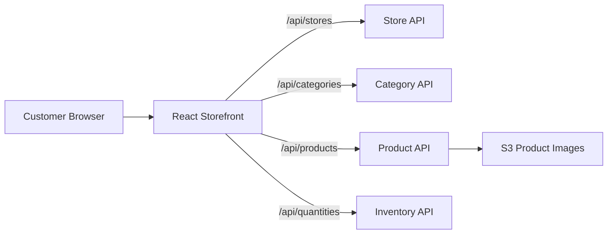

# A+mazon Customer Storefront

> **Applies to:** `client/`

The customer-facing React application for A+mazon. It lets shoppers select a store, browse a three-level product category hierarchy, view store-specific inventory, and see current product pricing and sale information.

For the complete system architecture and AWS deployment instructions, see the [root README](../README.md).

## Features

- Automatically loads available stores and selects the first store by default.
- Filters products by primary, secondary, and tertiary categories.
- Displays product images, descriptions, regular prices, and effective sale prices.
- Retrieves inventory separately for the selected store.
- Shows clear inventory states:
  - **Out of stock** when quantity is zero or lower.
  - **Only N left** when quantity is between 1 and 10.
  - **In stock** when quantity is above 10.
- Uses responsive Semantic UI card layouts for desktop, tablet, and mobile screens.
- Displays loading, empty-result, and request-error states.

## How It Works



The application keeps the selected store and category filters in the page-level state. Whenever one of those values changes, the product list is fetched again. Product IDs from that response are then used to retrieve store-specific quantities.

## Tech Stack

- React 18
- Create React App / `react-scripts` 5
- Semantic UI React and Semantic UI CSS
- Material UI and Emotion
- Browser Fetch API
- React Testing Library and Jest

## Backend Dependency

During development, `package.json` proxies requests to `http://localhost:8000`. The corresponding FastAPI application is located in `server/`.

| Method | Endpoint | Purpose |
| --- | --- | --- |
| `GET` | `/api/stores` | Load available stores |
| `GET` | `/api/categories` | Load the nested category hierarchy |
| `GET` | `/api/products` | Load products for a store with optional category filters |
| `GET` | `/api/quantities` | Load quantities for one or more product IDs at a store |

Supported `/api/products` query parameters:

- `store_id`
- `primary_category`
- `secondary_category`
- `tertiary_category`

The frontend does not require its own `.env` file in the current local configuration. In production, Nginx serves the React build and forwards `/api` requests to the customer FastAPI service.

## Run Locally

### Prerequisites

- Node.js 20
- npm
- The customer FastAPI service running on `http://localhost:8000`
- A configured PostgreSQL database with seeded store and product data

Start the backend first by following `server/README.md`, then install and start the frontend:

```bash
cd client
npm ci
npm start
```

Open <http://localhost:3000>.

The page should load a store automatically. If no products appear, confirm that the database has been seeded and that the backend is responding at <http://localhost:8000/docs>.

## Available Scripts

| Command | Purpose |
| --- | --- |
| `npm start` | Start the development server on port 3000 |
| `npm test` | Start the Jest test runner in watch mode |
| `npm run build` | Create an optimized production build in `build/` |
| `npm run eject` | Expose the Create React App configuration; this is irreversible |

For a non-interactive test run:

```bash
npm test -- --watchAll=false
```

## Project Structure

```text
client/
├── public/                     # Static HTML and browser assets
├── src/
│   ├── components/
│   │   ├── ProductItem.js      # Product card, pricing, and stock status
│   │   ├── category_button.js  # Hierarchical category selectors
│   │   ├── items.js            # Product and quantity loading
│   │   └── store_selection.js  # Store selector
│   ├── pages/
│   │   └── index.js            # Main storefront page and shared state
│   ├── services/
│   │   └── api.js              # Customer API client
│   ├── App.js                  # Application entry component
│   ├── App.css
│   ├── index.js
│   └── index.css
├── package.json
└── package-lock.json
```

## Production Build and Deployment

Create a local production build with:

```bash
npm run build
```

The repository-level deployment script builds this application and copies the generated static files to `/var/www/react` on the customer EC2 instance. Nginx serves the frontend and proxies API traffic to the FastAPI process managed by `systemd`.

From the repository root:

```bash
./scripts/deploy.sh
```

See the root README for infrastructure prerequisites, deployment prompts, AWS outputs, and teardown instructions.

## Testing Status

The project includes Jest and React Testing Library. The checked-in `src/App.test.js` is still the default Create React App scaffold test and does not validate the current storefront behavior.

Recommended next tests:

- Store loading and automatic default selection.
- Dependent primary, secondary, and tertiary category filters.
- Product refresh when the selected store or category changes.
- Regular and sale-price rendering.
- Loading, low-stock, out-of-stock, empty, and API-error states.
- Product and quantity response integration with a mocked API.

## Known Limitations

- The API base path and development proxy are fixed in source and `package.json` rather than configured through an environment variable.
- The UI has no search, sorting, pagination, cart, or checkout flow.
- Error messages are intentionally brief and do not yet provide retry actions.
- Product availability is fetched after products load, resulting in two requests per product-list refresh.
- Automated storefront-specific tests have not yet replaced the scaffold test.

## Troubleshooting

### The page shows `Fetch error`

Verify that the customer API is running on port 8000 and that `/api/stores`, `/api/categories`, `/api/products`, and `/api/quantities` return successful responses.

### No products are displayed

Confirm that a store is selected, the database is seeded, and the selected filters match products offered by that store.

### Images do not load

Confirm that the Terraform-created product-image bucket exists, the seed images were uploaded, and the stored product image URLs point to readable S3 objects.

### Port 3000 is already in use

Stop the other React development server before starting this app. The customer and management frontends both use port 3000 by default.
