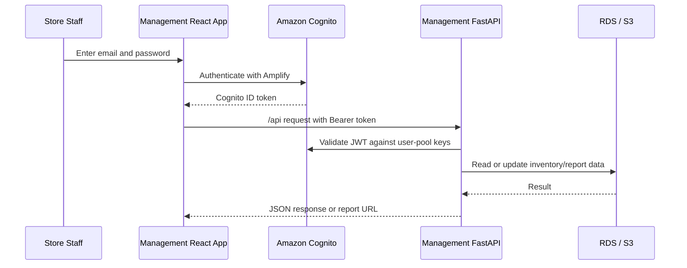

# A+mazon Inventory Management Portal

> **Applies to:** `management_web/`

The authenticated React administration interface for A+mazon. Store staff use it to manage product offerings and quantities, subscribe to scheduled sales reports, and download generated report files.

For the complete system architecture and AWS deployment instructions, see the [root README](../README.md).

## Features

- Signs staff in with an Amazon Cognito email account.
- Adds the authenticated user's Cognito ID token to every management API request.
- Selects a store and displays its currently offered products.
- Adds previously unoffered products to a store.
- Removes selected products from a store after confirmation.
- Edits multiple inventory quantities and saves them together.
- Creates scheduled sales-report subscriptions for a store or category.
- Supports minute, hourly, daily, weekly, and monthly report frequencies.
- Lists report subscriptions and shows active or paused status.
- Pauses, resumes, and deletes subscriptions.
- Lists generated reports with pagination and provides download links.
- Signs the current user out of the management session.

## Authentication and Request Flow



`src/services/api.js` obtains the current Amplify session before every request and sends the ID token as:

```http
Authorization: Bearer <cognito-id-token>
```

The management FastAPI service verifies the token's signature and audience with the Cognito user pool configuration.

## Tech Stack

- React 18
- Create React App / `react-scripts` 5
- AWS Amplify and Amplify Authenticator
- Amazon Cognito
- Semantic UI React and Semantic UI CSS
- Material UI and Emotion
- Browser Fetch API
- React Testing Library and Jest

## Required Environment Variables

Create `management_web/.env` before starting or building the application:

```dotenv
REACT_APP_USER_POOL_ID=<cognito-user-pool-id>
REACT_APP_CLIENT_ID=<cognito-app-client-id>
```

For an AWS deployment, both values are available from Terraform:

```bash
cd infra
terraform output -raw user_pool_id
terraform output -raw user_pool_client_id
```

The repository-level deployment script writes this `.env` file automatically before building the frontend.

> Do not commit local `.env` files. Although Cognito pool and client identifiers are not passwords, environment-specific configuration should remain outside source control.

## Backend Dependency

During development, `package.json` proxies `/api` requests to `http://localhost:8000`. The corresponding FastAPI application is located in `management_server/`.

| Method | Endpoint | Purpose |
| --- | --- | --- |
| `GET` | `/api/stores` | Load stores |
| `GET` | `/api/categories` | Load the category hierarchy |
| `GET` | `/api/products` | Load products offered by a store |
| `GET` | `/api/quantities` | Load store-specific quantities |
| `PUT` | `/api/quantities` | Save quantity changes |
| `GET` | `/api/unoffered-products` | Load products that may be added to a store |
| `POST` | `/api/products` | Offer products at a store |
| `DELETE` | `/api/products` | Remove products from a store |
| `POST` | `/api/subscribe` | Create a store or category report subscription |
| `GET` | `/api/subscriptions` | List the current user's subscriptions |
| `PATCH` | `/api/subscriptions/{task_id}/toggle` | Pause or resume a subscription |
| `DELETE` | `/api/subscriptions/{task_id}` | Stop a subscription |
| `GET` | `/api/report/{task_id}/files` | List downloadable report files with pagination |

All management endpoints require a valid Cognito bearer token.

## Run Locally

### Prerequisites

- Node.js 20
- npm
- A deployed or otherwise reachable Cognito user pool and app client
- At least one Cognito management user
- The management FastAPI service running on `http://localhost:8000`
- A configured PostgreSQL database
- AWS report-bucket access for report downloads

Start the management backend by following `management_server/README.md`. Then configure the Cognito environment variables and run:

```bash
cd management_web
npm ci
npm start
```

Open <http://localhost:3000> and sign in with a management-user email and password.

If the AWS environment has been provisioned but no management user exists, create one from the repository root:

```bash
./scripts/create_user.sh
```

The script creates a Cognito user with a temporary password. Cognito prompts the user to choose a new password during the first sign-in.

## Available Scripts

| Command | Purpose |
| --- | --- |
| `npm start` | Start the development server on port 3000 |
| `npm test` | Start the Jest test runner in watch mode |
| `npm run build` | Create an optimized production build in `build/` |
| `npm run eject` | Expose the Create React App configuration; this is irreversible |

For a non-interactive test run:

```bash
npm test -- --watchAll=false
```

## Project Structure

```text
management_web/
├── public/                          # Static HTML and browser assets
├── src/
│   ├── components/
│   │   ├── items.js                 # Offered-product table and quantity state
│   │   ├── product_item.js          # Product row, selection, and editing controls
│   │   ├── offer_item.js            # Modal for offering new store products
│   │   ├── store_selection.js       # Store selector
│   │   ├── subscribe_model.js       # Store/category report subscription modal
│   │   └── my_subscriptions_modal.js# Subscription status and report downloads
│   ├── pages/
│   │   └── index.js                 # Management dashboard and action state
│   ├── services/
│   │   └── api.js                   # Authenticated management API client
│   ├── App.js                       # Amplify configuration and Authenticator
│   ├── App.css
│   ├── index.js
│   └── index.css
├── package.json
└── package-lock.json
```

## Main User Workflows

### Manage store offerings

1. Select a store.
2. Choose **Offer New Product** to load products not currently offered there.
3. Select products and submit the offer request.
4. Select existing products and confirm removal when they should no longer be offered.

### Edit inventory

1. Select a store.
2. Enter quantity-edit mode.
3. Change one or more quantities.
4. Save all changes together or cancel to discard the local edits.

### Subscribe to reports

1. Open the subscription modal.
2. Choose either a store or category target.
3. Select the report frequency.
4. Confirm the subscription.
5. Use **My Reports** to pause, resume, or delete the subscription and download generated files.

Deleting a subscription stops future generation. Reports created during earlier subscribed periods remain available according to the backend's subscription-history rules.

## Production Build and Deployment

Create a local production build after setting the Cognito variables:

```bash
npm run build
```

The repository-level deployment script retrieves the Cognito identifiers from Terraform, writes the frontend `.env`, builds the application, and copies the static files to `/var/www/react` on the management EC2 instance. Nginx serves the frontend and proxies `/api` requests to the management FastAPI service managed by `systemd`.

From the repository root:

```bash
./scripts/deploy.sh
```

See the root README for infrastructure prerequisites, deployment prompts, AWS outputs, and teardown instructions.

## Testing Status

The project includes Jest and React Testing Library. The checked-in `src/App.test.js` is still the default Create React App scaffold test and does not validate Cognito authentication or the management workflows.

Recommended next tests:

- Authenticator loading, successful sign-in, expired-token, and sign-out states.
- Bearer-token attachment by the API client.
- Store selection and offered-product loading.
- Offer, remove, and bulk quantity-edit confirmation flows.
- Store and category subscription creation.
- Pause, resume, and delete subscription actions.
- Report pagination, empty states, failures, and download links.
- Unauthorized and expired-session API responses.

## Security Notes

- Never store user passwords, AWS credentials, or tokens in source code.
- The frontend must not be treated as an authorization boundary; protected operations must remain enforced by the management API.
- Cognito token validation depends on the configured region, user-pool ID, and client ID matching the deployed backend.
- Production deployments should use HTTPS so credentials and bearer tokens are never sent over plain HTTP.
- Report download URLs should remain time-limited and authorized by the backend.

## Known Limitations

- The development API target is fixed through the `package.json` proxy rather than an environment-specific API URL.
- The customer and management frontends both default to port 3000 and should be run separately unless ports and CORS settings are adjusted.
- The frontend does not currently expose detailed recovery actions for failed API requests.
- Automated application-specific tests have not yet replaced the scaffold test.
- The current production infrastructure serves HTTP; HTTPS and a custom domain remain future work.

## Troubleshooting

### Cognito configuration error or blank sign-in screen

Confirm that `REACT_APP_USER_POOL_ID` and `REACT_APP_CLIENT_ID` are present before starting or building the app. Restart the development server after changing `.env`.

### Sign-in fails for a new user

Confirm that the user exists in the expected Cognito pool and complete the required temporary-password change during first sign-in.

### API requests return `401 Unauthorized`

Confirm that the frontend and management backend use the same Cognito user-pool ID, app-client ID, and AWS region. Sign out and sign in again if the session has expired.

### Inventory or subscriptions do not load

Verify that `management_server` is running on port 8000, its database settings are valid, and the browser request contains an `Authorization: Bearer ...` header.

### Reports appear but downloads fail

Confirm that the report object exists in the private S3 report bucket and that the backend can generate a valid authorized download URL.
